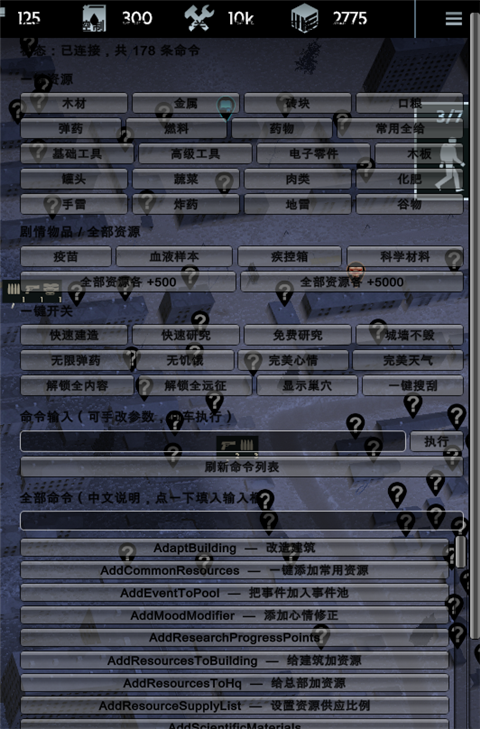

# IFZ Cheat Panel

**中文** | [English](#english)

《无感染区》(Infection Free Zone) 的游戏内 F7 控制台面板 —— BepInEx 5 插件。



> 非官方项目，与开发商 Jutsu Games 无任何关联。仅供单机自用/学习交流。

## 功能

- **F7 呼出面板**，可拖动窗口、亮色主题
- **命令自动发现**：运行时反射扫描游戏 `Commands.GameConsoleCommandHandler` 上所有
  `[GameCommand]` 方法（当前版本 178 条），不硬编码命令表，游戏小版本更新不会整体失效
- **全中文**：内置命令中文说明，搜索支持中英混搜；可通过 `BepInEx/config/命令中文对照.txt` 覆盖
- **一键资源**：木材 / 金属 / 砖块 / 口粮 / 弹药 / 燃料 / 药物 / 基础工具 / 高级工具 /
  电子零件 / 木板 / 罐头 / 蔬菜 / 肉类 / 化肥 / 手雷 / 炸药 / 地雷 / 谷物
- **剧情物品**：疫苗 / 血液样本 / 疾控箱 / 科学材料
- **全部资源各 +500 / +5000**：遍历游戏公共资源列表逐个写入
- **一键开关**：快速建造、快速研究、免费研究、城墙不毁、无限弹药、无饥饿、完美心情、
  完美天气、解锁全内容、解锁全远征、显示巢穴、一键搜刮
- **自由命令**：手动输入命令 + 参数执行，结果直接显示在面板上

## 原理

- 游戏是 **Unity 6 (6000.x) + Mono** 后端，通过 **BepInEx 5** 注入
- 加资源不走控制台命令，而是反射取 `HqController.MainHeadquarter.ResourcesContainer`
  后调用 `ForceAddResource`（与游戏自带「一键加资源」完全相同路径，可绕过容量限制）
- 全程反射，**不修改、不反编译游戏程序集**

## 安装

1. 先安装 **BepInEx 5.4.23+ (x64)** 到游戏根目录（Steam → 右键游戏 → 管理 → 浏览本地文件）
   - 校验安装成功的标志：游戏目录出现 `winhttp.dll`、`BepInEx\core`
2. 把 `IfzCheat.dll` 放到：
   ```
   <游戏目录>\BepInEx\plugins\IfzCheat.dll
   ```
3. 启动游戏，进入存档后按 **F7**

## 自行编译

需要 .NET Framework 4.x 的 `csc.exe`（Windows 自带）和已安装 BepInEx 的游戏目录。

```powershell
powershell -ExecutionPolicy Bypass -File .\build.ps1 -Install
# 或指定游戏目录
powershell -ExecutionPolicy Bypass -File .\build.ps1 -GameDir "D:\SteamLibrary\steamapps\common\Infection Free Zone" -Install
```

编译产物：`bin\IfzCheat.dll`

## 排错

| 现象 | 处理 |
|---|---|
| F7 没反应 | 检查 `BepInEx\LogOutput.log` 是否有 `Loading [IFZ Cheat Panel ...]` |
| 面板显示「等待进入游戏」 | 命令处理器在进存档后才创建，读档后自动扫描 |
| 面板显示「未找到命令实例，游戏版本可能已变动」 | 游戏大更新导致类型改名，请提 issue |
| 加资源没反应 | 看 `BepInEx\ifzcheat_diag.txt` 最后的日志行 |
| 顶部 `►` 提示「总部还没建好」 | 需要先建好总部（HQ）才能写入资源 |

调试日志位置：`<游戏目录>\BepInEx\ifzcheat_diag.txt`

## 注意

- 游戏内置 **TrainerMonitor**（检测修改器），使用可能影响成就/统计，自行权衡
- 剧情类物品（疫苗等）刷入仓库不一定推进剧情进度，建议先存档

## 许可

MIT。BepInEx 为 LGPL-2.1，本项目仅依赖它，不包含其源码。

---

## English

In-game cheat panel for **Infection Free Zone** (Unity 6 / Mono), loaded by **BepInEx 5**.

Press **F7** in game to open a draggable panel that:

- **Auto-discovers console commands** at runtime by reflecting every `[GameCommand]`
  method on `Commands.GameConsoleCommandHandler` (178 commands in the current build),
  so it does not break on minor game updates.
- **One-click resources** (wood, metal, bricks, rations, ammo, fuel, meds, tools,
  electronics, planks, canned food, vegetables, meat, fertilizer, grenades, explosives,
  mines, grain) plus story items (vaccine, blood samples, CDC case, scientific material).
- **Add every public resource at once** (+500 / +5000).
- **One-click toggles**: fast construction / research, free research, immortal walls,
  infinite ammo, no hunger, perfect mood / weather, unlock all content & expedition tiles,
  reveal lairs, scavenge everything.
- **Free-form command box** with argument parsing and inline result feedback.

Resources are injected by calling `ResourcesContainer.ForceAddResource` on the HQ
container (the exact path the game's own `AddCommonResources` uses), **not** via console
commands — `AddResourcesToHq` silently returns when resource data is null.

Everything is done through reflection: **no game files are modified or decompiled**.

### Install

1. Install **BepInEx 5.4.23+ (x64)** into the game root folder.
2. Copy `IfzCheat.dll` into `<GameDir>\BepInEx\plugins\`.
3. Launch the game, load a save, press **F7**.

### Build

```powershell
powershell -ExecutionPolicy Bypass -File .\build.ps1 -Install
```

### Notes

- The game ships a `TrainerMonitor`; achievements/statistics may be affected.
- Story items such as the vaccine may not advance quest progress — back up your save first.

### License

MIT. BepInEx is LGPL-2.1 and is only a dependency, not bundled with this project.
